<!-- ============ HERO ============ -->
<picture>
  <source media="(prefers-color-scheme: dark)" srcset="assets/hero-dark.svg" />
  <source media="(prefers-color-scheme: light)" srcset="assets/hero-light.svg" />
  
</picture>

  
  
  

<!-- ============ FOCUS ============ -->
<picture>
  <source media="(prefers-color-scheme: dark)" srcset="assets/focus-dark.svg" />
  <source media="(prefers-color-scheme: light)" srcset="assets/focus-light.svg" />
  
</picture>

<!-- ============ PROJECTS ============ -->
<!-- 由 .github/workflows/readme-projects.yml 每日生成，产物推送到 output 分支 -->
<a href="https://github.com/KurohaneKaoruko?tab=repositories">
  <picture>
    <source media="(prefers-color-scheme: dark)" srcset="https://raw.githubusercontent.com/KurohaneKaoruko/KurohaneKaoruko/output/assets/projects/projects-dark.svg" />
    <source media="(prefers-color-scheme: light)" srcset="https://raw.githubusercontent.com/KurohaneKaoruko/KurohaneKaoruko/output/assets/projects/projects-light.svg" />
    
  </picture>
</a>

<!-- ============ TELEMETRY ============ -->

  

<picture>
  <source media="(prefers-color-scheme: dark)" srcset="https://streak-stats.demolab.com?user=KurohaneKaoruko&amp;theme=transparent&amp;hide_border=true" />
  <source media="(prefers-color-scheme: light)" srcset="https://streak-stats.demolab.com?user=KurohaneKaoruko&amp;theme=transparent&amp;hide_border=true" />
  
</picture>

  
  

  
  

<code>// CONTRIBUTION GRAPH — 贡献图谱</code>

<picture>
  <source media="(prefers-color-scheme: dark)" srcset="https://raw.githubusercontent.com/KurohaneKaoruko/KurohaneKaoruko/output/assets/snake/github-snake-dark.svg" />
  <source media="(prefers-color-scheme: light)" srcset="https://raw.githubusercontent.com/KurohaneKaoruko/KurohaneKaoruko/output/assets/snake/github-snake.svg" />
  
</picture>

<picture>
  <source media="(prefers-color-scheme: dark)" srcset="https://raw.githubusercontent.com/KurohaneKaoruko/KurohaneKaoruko/output/assets/profile-3d-contrib/profile-night-rainbow.svg" />
  <source media="(prefers-color-scheme: light)" srcset="https://raw.githubusercontent.com/KurohaneKaoruko/KurohaneKaoruko/output/assets/profile-3d-contrib/profile-green-animate.svg" />
  
</picture>

<!-- ============ FOOTER ============ -->

  

