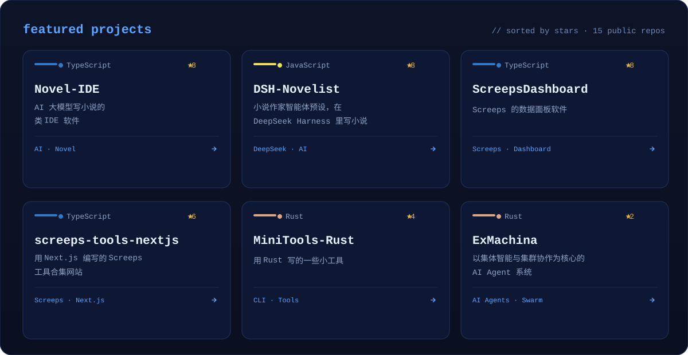
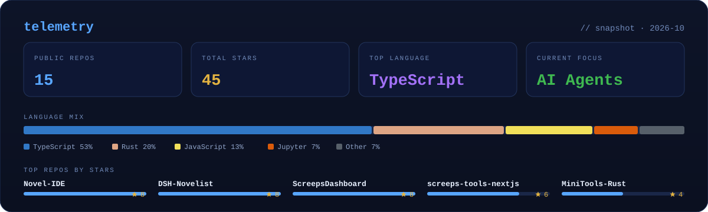
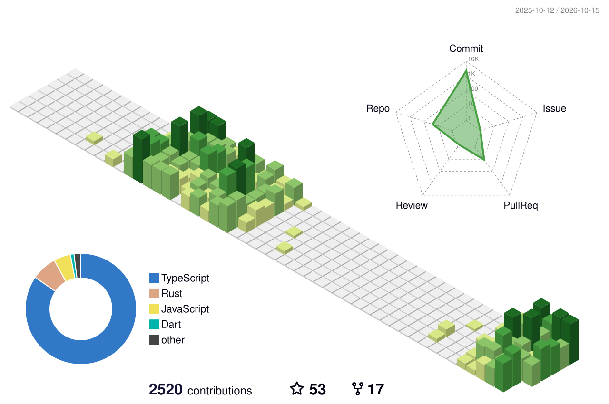

<!-- ============ HERO ============ -->
<picture>
  <source media="(prefers-color-scheme: dark)" srcset="assets/hero-dark.svg" />
  <source media="(prefers-color-scheme: light)" srcset="assets/hero-light.svg" />
  
</picture>

  
  
  
  

<!-- ============ ABOUT / STACK ============ -->
<picture>
  <source media="(prefers-color-scheme: dark)" srcset="assets/about-dark.svg" />
  <source media="(prefers-color-scheme: light)" srcset="assets/about-light.svg" />
  
</picture>

<!-- ============ PROJECTS ============ -->
<picture>
  <source media="(prefers-color-scheme: dark)" srcset="assets/projects-dark.svg" />
  <source media="(prefers-color-scheme: light)" srcset="assets/projects-light.svg" />
  
</picture>

<!-- ============ TELEMETRY SNAPSHOT ============ -->
<picture>
  <source media="(prefers-color-scheme: dark)" srcset="assets/dashboard-dark.svg" />
  <source media="(prefers-color-scheme: light)" srcset="assets/dashboard-light.svg" />
  
</picture>

<code>// LIVE TELEMETRY — 实时统计</code>

<picture>
  <source media="(prefers-color-scheme: dark)" srcset="https://streak-stats.demolab.com?user=KurohaneKaoruko&amp;theme=transparent&amp;hide_border=true" />
  <source media="(prefers-color-scheme: light)" srcset="https://streak-stats.demolab.com?user=KurohaneKaoruko&amp;theme=transparent&amp;hide_border=true" />
  
</picture>

  
  

  
  

<code>// CONTRIBUTION GRAPH — 贡献图谱</code>

<picture>
  <source media="(prefers-color-scheme: dark)" srcset="https://raw.githubusercontent.com/KurohaneKaoruko/KurohaneKaoruko/output/github-snake-dark.svg" />
  <source media="(prefers-color-scheme: light)" srcset="https://raw.githubusercontent.com/KurohaneKaoruko/KurohaneKaoruko/output/github-snake.svg" />
  
</picture>

<picture>
  <source media="(prefers-color-scheme: dark)" srcset="assets/profile-3d-contrib/profile-night-rainbow.svg" />
  <source media="(prefers-color-scheme: light)" srcset="assets/profile-3d-contrib/profile-green-animate.svg" />
  
</picture>

<!-- ============ FOOTER ============ -->
<picture>
  <source media="(prefers-color-scheme: dark)" srcset="assets/footer-dark.svg" />
  <source media="(prefers-color-scheme: light)" srcset="assets/footer-light.svg" />
  
</picture>

